# Viewora — System Architecture

## 1. High-Level Layers

1. **Presentation & Routing (`src/app/[locale]/`)**:
   - Next.js 15 App Router with locale middleware (`src/middleware.ts`) supporting `en`, `pt-BR`, `es`, `de`, and `fr`.
   - Public SEO routes statically prerendered (`/[locale]`, `/[locale]/instagram-*`, `/[locale]/about|contact|faq|blog|privacy|terms|cookies|data-transparency|responsible-use`, `/sitemap.xml`, `/robots.txt`).
   - Authenticated customer routes (`/[locale]/dashboard/*`) and administrative routes (`/[locale]/admin/*`) explicitly forced dynamic (`export const dynamic = 'force-dynamic'`) with server-side session and role enforcement.
2. **Independent PostgreSQL Database & Prisma ORM (`prisma/`, `src/lib/db/`)**:
   - Self-hosted PostgreSQL 16 (`viewora` + `viewora_test`) orchestrated via `docker-compose.yml` with persistent named volume `viewora_pgdata`, health checks, least-privilege `viewora_app` role, and loopback-only dev port binding.
   - Prisma ORM (`prisma/schema.prisma`, versioned SQL migrations under `prisma/migrations/`, singleton client `src/lib/db/prisma.ts`, and modular domain repositories under `src/lib/db/repositories/`).
   - Defense-in-depth authorization: strict server-side repository ownership/membership checks + native PostgreSQL Row-Level Security (`20261125000002_postgres_rls_and_roles`) using transaction-local `app.current_user_id` / `app.current_user_role`.
   - Persistent local file storage abstraction (`src/lib/storage/local-files.ts`) replacing external object storage with owner isolation and path-traversal protection.
3. **Independent Authentication (`src/lib/auth/`, `src/app/api/auth/`)**:
   - Auth.js v5 (`next-auth`) with `@auth/prisma-adapter` + application-owned registration, bcrypt (`bcryptjs` cost 12) password hashing, revocable PostgreSQL `Session` cookies (`HttpOnly`, `SameSite=Lax`, `Secure` in production), single-use SHA-256 hashed email-verification & password-reset tokens, sliding-window login rate limiting, anti-enumeration responses, and safe redirect sanitization.
   - Zero runtime dependency on Supabase.
4. **Modular Data Provider Layer (`src/lib/providers/`)**:
   - Uniform `InstagramDataProvider` contract returning `ProviderResponse<T>` with explicit `dataClass` (`live` | `cached` | `estimate` | `demo`), `availability`, `freshness`, `confidence`, and `limitations`.
   - `ProviderRegistry` enforces a hard invariant that `demo_fixture` responses can never claim `live` or `cached` provenance.
5. **Centralized Entitlements & Pricing (`src/lib/entitlements/`)**:
   - Authoritative `plans`, `plan_billing_options`, `plan_entitlements`, `subscriptions`, and `user_entitlement_overrides` managed via `entitlements.repo.ts` and `resolveEntitlements()`.
   - Payments remain strictly disabled (`PAYMENTS_ENABLED=false`, `payments_enabled` feature flag locked `false`).
6. **AI Intelligence, Automation, Health & Referrals**:
   - `src/lib/ai/gemini.ts` — Official Google Gemini REST integration (inactive until `GEMINI_API_KEY` is configured) with prompt-injection sandboxing, USD budgets, kill switch, and transparent deterministic fallback.
   - `src/lib/jobs/queue.ts`, `src/lib/email/resend.ts` (inactive by default), `src/lib/referrals/service.ts`, and `src/app/api/health/route.ts` (live PostgreSQL `SELECT 1` health check).

## 2. Database Entity-Relationship Diagram

```mermaid
erDiagram
  User ||--o| UserPreference : has
  User ||--o{ Account : links
  User ||--o{ Session : holds
  User ||--o{ EmailVerificationToken : verifies
  User ||--o{ PasswordResetToken : resets
  User ||--o{ Workspace : owns
  User ||--o{ WorkspaceMember : joins
  User ||--o{ Subscription : subscribes
  User ||--o{ UserEntitlementOverride : overrides
  User ||--o{ Notification : receives
  User ||--o{ SupportTicket : opens
  User ||--o{ ConsentRecord : grants
  User ||--o{ DataExportRequest : requests
  User ||--o{ AuditLog : performs

  Workspace ||--o{ WorkspaceMember : includes
  Workspace ||--o{ WorkspaceInvitation : invites
  Workspace ||--o{ ResearchFolder : organizes
  Workspace ||--o{ SavedProfile : tracks
  Workspace ||--o{ ComparisonProject : compares
  Workspace ||--o{ AiReport : generates
  Workspace ||--o{ ReportExport : exports
  Workspace ||--o{ ActivityEvent : observes
  Workspace ||--o{ ProviderConnection : connects

  ResearchFolder ||--o{ SavedProfile : groups
  SavedProfile ||--o{ ProfileSnapshot : captures
  SavedProfile ||--o{ ProfileResearchNote : annotates
  ReportTemplate ||--o{ AiReport : formats

  Plan ||--o{ PlanBillingOption : prices
  Plan ||--o{ PlanEntitlement : grants
  Plan ||--o{ Subscription : assigns
  Plan ||--o{ Order : bills

  Order ||--o{ Invoice : issues
  Order ||--o{ PaymentRecord : records
  Invoice ||--o{ PaymentRecord : settles

  SupportTicket ||--o{ SupportMessage : threads
  SupportTicket ||--o{ SupportTicketStatusHistory : tracks
  BackgroundJob ||--o{ JobAttempt : retries
  Experiment ||--o{ ExperimentAssignment : assigns
  ReferralCode ||--o{ ReferralAttribution : attributes
```

